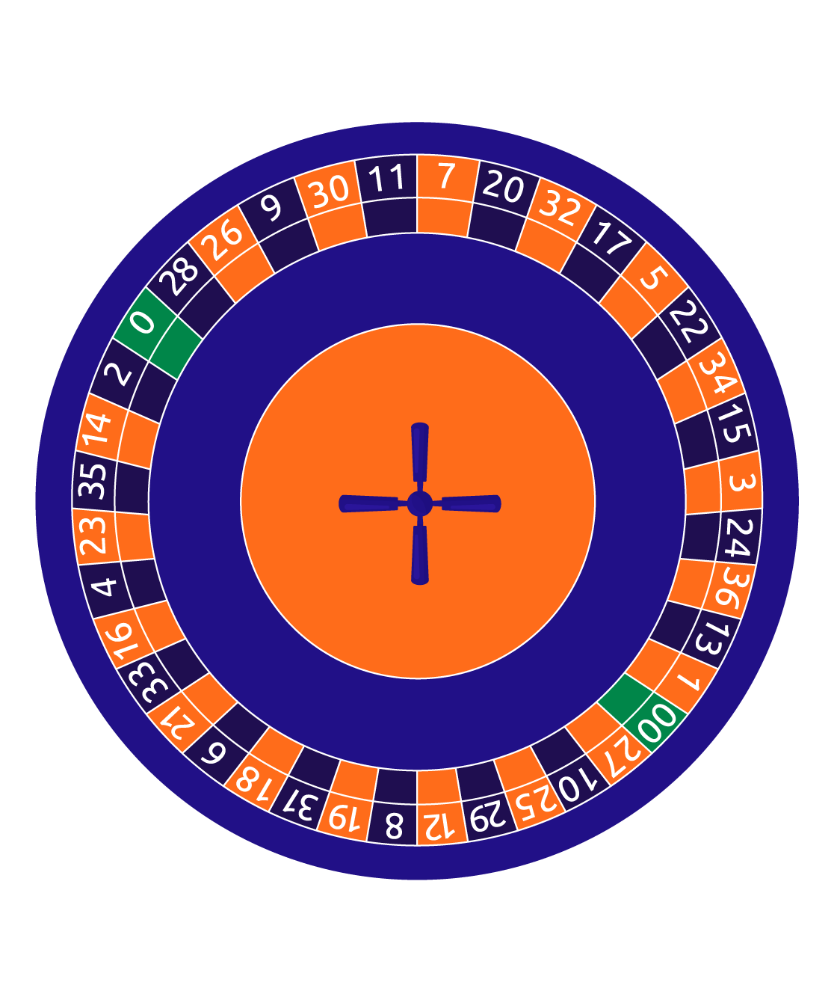

```{r}
#| echo: false
#| include: false
library(tidyverse)
```


## Bead Model

```{r}
beads <- c("blue", "blue", "blue", "red", "red")
x <- if_else(sample(beads, 1) == "blue", 1, 0)

xs <- replicate(10, if_else(sample(beads, 1) == "blue", 1, 0))
xs
```


## Roulette

{fig-alt="American Roulette Wheel. Pockets are numbered 00, 0, 1, ..., 36, with 00 and 0 colored green and 1-36 colored either red or black (in this image, orange or blue). The number order is 0-28-26-9-30-11-7-20-32-17-5-22-34-15-3-24-36-13-1-00-27-10-25-29-12-8-19-31-18-6-21-33-16-4-23-35-14-2, and adjacent nonzero numbers alternate red and black. 28 is black and 27 is red, 1 is red and 2 is black."}


## Roulette 

```{r}
#| echo: true
library(tidyverse)
roulette <- tibble(
  pocket_no = c("00", 0:36),
  color = c("green", "green", 
            "red", "black", "red", "black", "red", "black", 
            "red", "black", "black", "black", "black", "red", 
            "black", "red", "black", "red", "black", "red", 
            "red", "black", "red", "black", "red", "black", 
            "red", "red", "red", "black", "black", "red",
            "black", "red", "black", "red", "black", "red")
)

roulette |> slice_sample(n = 10)
```

## Roulette

We can write a function to create a random variable by mapping the sampled pocket to a numerical outcome -- how much money the casino wins or loses. 

```{r}
#| echo: true
casino_rv <- function(x) {
  if_else(x != "red", 1, -1)
}

```

## Roulette

```{r}
#| echo: true
set.seed(2034987234)
roulette |> slice_sample(n = 10, replace = T) |>
  mutate(outcome = casino_rv(color))
```

## Roulette

Then, we can summarize to see what the long-run outcome is:
```{r}
#| echo: true
set.seed(223486234)
roulette |> slice_sample(n = 1000, replace = T) |>
  mutate(outcome = casino_rv(color)) |>
  summarize(expectation = mean(outcome))
```


## Roulette
```{r}
#| echo: true
set.seed(223486234)
roulette |> slice_sample(n = 1000000, replace = T) |>
  mutate(outcome = casino_rv(color)) |>
  summarize(expectation = mean(outcome))
```

## Math Notation

$X = \begin{cases} 1 & \text{green or black}\\-1 & \text{red}\end{cases}$

$P(X = 1) = \frac{20}{38} = \frac{10}{19}$

$P(X = -1) = \frac{18}{38} = \frac{9}{19}$


## Math Notation
The expected value for the casino is
$$E(X) = 1\cdot P(X=1) + (-1)\cdot P(X=-1) = \frac{10}{19}-\frac{9}{19} = \frac{1}{19}$$

## Math Notation

And the standard deviation is 

$$\begin{align}SD(X) &= P(X=1)\left[1-\frac{1}{19}\right]^2 + P(X=-1)\left[-1-\frac{1}{19}\right]^2 \\&= \frac{10}{19}\frac{18^2}{19^2} +  \frac{9}{19}\frac{20^2}{19^2} = \frac{6840}{6859} \\&\approx 0.9972 \end{align}$$

