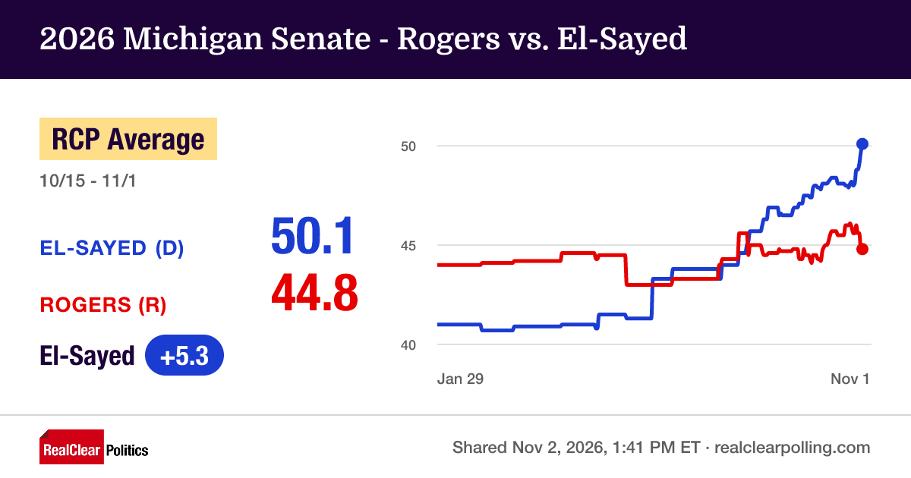
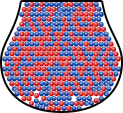
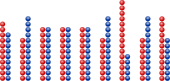
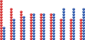
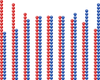

## Polls

{fig-alt="The Real Clear Politics graph of the 2026 Michigan Senate race between Abdul El-Sayed and Mike Rogers. The poll average starts out with Rogers ahead in January, and flips to favor El-Sayed over the summer, with an increasing gap as November approaches." width="80%"}


## Population

{fig-alt="An image of 201 red and 214 blue balls in an urn" width="50%"}

$P = \frac{214}{415} = .515$ [**(we don't usually know this)**]{.emph .blue-dk}

## Samples

{fig-alt="Nine samples of 20 balls from the urn. They break down as 11-9, 8-12, 10-10, 10-10, 10-10, 8-12, 15-5, 8-12, 12-8, red-blue." width="80%"}

## Samples

{fig-alt="Nine samples of 20 balls from the urn. They are sorted so that red-dominant samples are on the left and blue-dominant samples are on the right. The samples break down as 15-5, 12-8, 11-9, 10-10, 10-10, 10-10, 8-12, 8-12, 8-12, red-blue." width="80%"}

$\overline X = \frac{\text{# blue balls}}{20}$

```{r}
c(5, 8, 9, 10, 10, 10, 12, 12, 12)/20
```

## Samples

{fig-alt="Nine samples of 40 balls from the urn. They are sorted so that red-dominant samples are on the left and blue-dominant samples are on the right. The samples break down as 25-15, 24-16, 21-19, 20-20, 20-20, 20-20, 19-21, 18-22, 16-24, red-blue." width="80%"}

$\overline X = \frac{\text{# blue balls}}{40}$

```{r}
c(15, 16, 19, 20, 20, 20, 21, 22, 24)/40
```


## Sample Variability

$$\sigma^2_{\overline X} = \frac{p(1-p)}{N}$$

Our best estimate of $\sigma^2$ is $$\frac{\overline X (1-\overline X)}{N}$$
