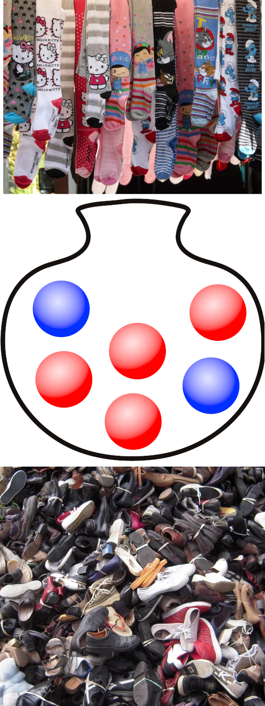
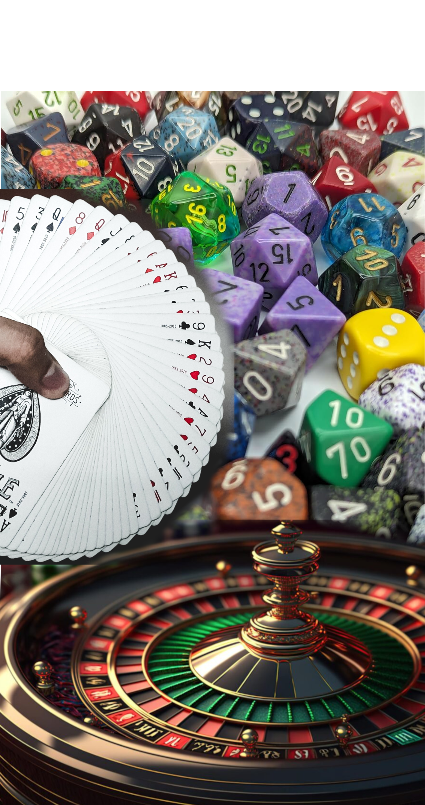

# What is Probability, anyways?

::: {layout-ncol=5 layout-valign="bottom"}
{fig-alt="Three images. The first shows socks hanging on a line. The second shows a drawing of an urn (vase) holding four red ball shaped objects and two blue ball shaped objects. The last shows a pile of shoes, some of which have visible mates and others which do not."}

{fig-alt="An overlay of 3 images of gambling paraphenalia. The first is an array of different types of dice, from classic 6-sided dice to 20-sided dice, but also includeing 10-sided dice, 12-sided dice, dice with pips (dots), dice with printed numbers, and in all sorts of colors and textures. The second shows a dealer's hand spreading a deck of cards out in a circle to demonstrate that the deck is fair and shuffled. The bottom is a roulette wheel, where a bouncing ball lands on a wheel segment and determines the outcome."}

{fig-alt="A series of marbles that seem to contain similar galazies, with each marble at a slightly different angle."}

{fig-alt="The precipitation forecast for Logan, UT October 22-31, showing the probability of precipitation for each day; it varies between 100% 'tonight' and 4% approximately a week away. In this case, probability can be thought of as the trust we have in the forecast that it will rain at our location."}

Probability is harder to define than you'd expect <br/><br/><br/><br/>
It involves a lot of philosophy. <br/><br/><br/><br/>
These are a few different ways we interpret or use probability in everyday life.<br/><br/><br/><br/>

:::

## Connecting Probability Models

1. Gambling model 

2. Let's simplify that, it's too hard -> Relative Frequency Model

3. Ok, but what if we have a **lot** of things? -> Multiverse    
"The long-run proportion of times the event occurs when an experiment is repeated independently and under identical conditions, infinitely many times" (from the book)    
[AKA "Frequentist" probability]{.fragment .emph .pink-dk}

4. Frequentists are nuts. What matters is how much you believe something will happen -- "Bayesian" statisticians.

[XKCD digression](https://xkcd.com/1132/)

# [Monte Carlo]{style="background: #ffffff;"} {background-image="images/monte-carlo.webp" background-size="cover"}

## Steps

1. Create a vector or tibble of things to sample from
```{r}
#| message: false
#| warning: false
#| echo: true
library(tidyverse)
deck <- crossing( # <1>
  suit = c("Hearts", "Spades", "Clubs", "Diamonds"), # <2>
  tibble( # <3>
    face = c("02", "03", "04", "05", "06", "07", # <3>
             "08", "09", "10", "Jack", "Queen",  # <3>
             "King", "Ace"), # <3>
    points = c(2:10, 10, 10, 10, 11) # <3>
  ) # <3>
)
head(deck)
```
1. The `crossing` function creates all combinations of the things passed in to it -- in this case, the suits, and the tibble with face values and points.
2. Define the four suits that exist in a deck of cards.
3. Define the face values and the points. We have to pass these in as a tibble because we don't want all combinations of face values and points -- each face value has a separate meaning. If we were going past the initial deal, we could handle Aces separately.

## Steps

2. Use `sample` (or `slice_sample()` for a tibble) to pick objects from your **sampling space** at random.
```{r}
#| message: false
#| warning: false
#| echo: true
set.seed(19900321) # <1>
single_sample <- deck |> 
  slice_sample(n=2) # <2>
single_sample
```
1. When sampling, always set a seed so you get the same results every time. I use birthdays in yyyymmdd form a lot (this is from a friend).
2. `slice_sample` allows you to choose a proportion of the rows (with the `prop` argument) or the raw number (with the `n` argument), which is more appropriate here. You can also set different probabilities for each row with `weight_by`.  

```{r}
#| include: false
options(width=50)
```

## Steps

3. Evaluate your draw in a way that gets you (hopefully) a single number, like an initial blackjack score.

```{r}
#| message: false
#| warning: false
#| echo: true
set.seed(19900321) # <1>
deck |>
  slice_sample(n=2) |>
  summarize(points = sum(points)) # <2>
```
1. Setting the seed means we get the same results in this chunk
2. We summarize to one row to get the initial score for blackjack, where you're dealt two cards initially and have to decide what to do. In this case you probably? want to stay, but we can evaluate that with Monte Carlo Simulation.

## Steps

4. Repeat a LOT of times, but not infinitely many times, because I don't have that kind of time.

```{r}
#| echo: true
#| cache: true
library(infer) # Tidyverse library
set.seed(19900321) # <1>
results <- deck |>
  rep_slice_sample(n = 2, reps = 1000000) |> # <2>
  summarize(points = sum(points)) # <3>

head(results)
```
1. Set the seed because we're being good and we want results that stay the same
2. use `rep_slice_sample` from the `infer` package to slice things but also replicate them. It creates a grouped data frame based on the `replicate` variable that it creates.
3. Use the same summary function we used before to get the point distribution.


## Steps

5. Use your results to understand the distribution!

```{r}
#| echo: true
#| fig-width: 10
#| fig-height: 3
#| out-width: 100%
#| tidy: styler
#| width: 50 
theme_set(theme_bw())
ggplot(results, aes(x = points)) + 
  geom_histogram(fill = "grey", color = "black", 
                 binwidth = 1, center = 1) # <1>
```
1. With discrete whole-number distributions, it's usually best to set your bin width to something sensible (1 in this case) and set bin to be centered on the whole numbers so that it's not ambiguous what is included in each bin. Then, we know for sure that 4 and 22 (two twos and two aces) are both showing up in our sample, occasionally.

## Some Things to Consider

1. Does the order matter? 

    - no, for blackjack -- [Combination]{.emph .blue-dk}
    - yes, for lots of other things! -- [Permutation]{.emph .sage-dk}

2. Sampling with or without replacement?

    - Do you put the thing back before drawing another?
    
Setting up the right programming approach is sometimes hard!

::: fragment
::: callout-tip
### Tips 
::: incremental

- sketch it out

- physically do the thing with items, multiple times

- THEN think about how to write the code

:::
:::
:::