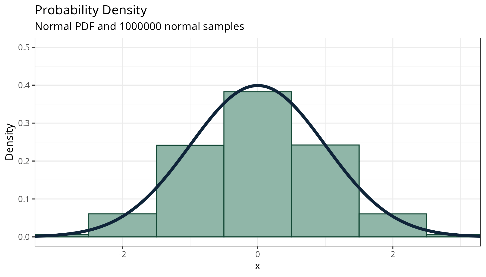

```{r}
#| label: setup
#| include: false

library(tidyverse)
library(dslabs)
library(animate)
data(heights)
theme_set(theme_bw())
```

## A Picture-Book Overview: Continuous Probability

::: {layout-ncol=2 layout-valign="top"}

```{r}
#| fig-width: 6
#| fig-height: 6
#| fig-alt: An empirical CDF of height by sex, which is shown in color. 
#| fig-cap: A CDF relates the probability $<=$ a value to the value itself.
height_sum <- heights |> group_by(sex) |> summarize(height = mean(height))
heights |>
  ggplot(aes(x = height, color = sex)) + 
  geom_step(stat="ecdf") + 
  geom_text(data =  height_sum, aes(label = sex, y = 0.5), 
            hjust = -.1) + 
  guides(color="none") + 
  theme(axis.title.y = element_blank()) + 
  ggtitle("Empirical Cumulative Density Function")
```


```{r}
#| fig-width: 6
#| fig-height: 6
#| fig-alt: An empirical PDF of height by sex, which is shown in color. 
#| fig-cap: A PDF relates the probability of a single value** to the value itself.

max_dens <- function(x) {
  dens <- density(x)
  location_max <- which.max(dens$y)
  tibble(x = dens$x[location_max], y = dens$y[location_max])
}
height_sum <- heights |> group_by(sex) |> summarize(dens = max_dens(height)) |>
  unnest(dens)
heights |>
  ggplot(aes(x = height, color = sex)) + 
  geom_density() + 
  geom_text(data =  height_sum, aes(x = x, y = y, label = sex), hjust = -.1) + 
  guides(color="none") + 
  theme(axis.title.y = element_blank()) + 
  ggtitle("Empirical Probability Density Function")
```

:::

[** Technically, the probability of any single value in a continuous variable is 0. But, we can think of a small neighborhood around each value instead.]{.bottom}


## Cumulative Distribution Functions

```{r}
n <- 10000
set.seed("204732342")
data <- tibble(
  x = rnorm(n)
)

ecdf <- ecdf(data$x)

ndens <- tibble(x = seq(-4,4, .01), pdf = dnorm(x), cdf = pnorm(x))


ggplot(ndens, aes(x = x, y = cdf)) + 
  geom_step(data = data, aes(x = x, color = "empirical"), 
            stat = "ecdf", inherit.aes = F, size = 1.5) + 
  geom_line(aes(color = "actual"), size = 1, alpha = .75) + 
  scale_color_manual("CDF Type", values = c("actual" = "#0F2439", "empirical" = "#8e4506")) + 
  ylab("Cumulative Probability") + 
  ggtitle(sprintf("Cumulative Distribution Function", subtitle = "Normal Distribution (Theoretical) and %d samples (Empirical)", n)) + 
  coord_cartesian(xlim = c(-3,3))

```


## Probability Density Functions

PDFs: Like histograms shrinking binwidth to (very close to) 0... but the math is complicated.

{fig-alt="A gif showing the basic plot of a normal PDF (line) with a histogram drawn from normal samples underneath. As time increases, the binwidth shrinks until it is hard to see single bins any longer. As this happens, the tops of the bins become a relatively good approximation for the normal PDF curve."}
```{r}
#| errors: false
#| warning: false
#| message: false
#| fig-alt: A normal probability density curve with a 100,000 point sample underneath drawn as a histogram. The histogram bins approximate the curve.
#| layout-ncol: 2
#| fig-height: 4
#| fig-width: 7
#| include: false
#| eval: false
n <- 1000000
set.seed("204732342")
data <- tibble(
  x = rnorm(n)
)

library(gifski)
binwidth <- sort(c(1/2^(0:5), 1/3^(1:4), 1/5^(1:3), 1/7^(1:2)), decreasing = T)

for(i in binwidth) {
  p <- ggplot(data, aes(x = x)) + 
  geom_histogram(aes(y = after_stat(density)), 
                 color = "#124734", fill = "#90b6a8", 
                 start = 0, binwidth = i) + 
  geom_line(data = ndens, aes(x = x, y = pdf), 
            color = "#0F2439", size = 1.5) + 
  coord_cartesian(xlim = c(-3,3), ylim = c(0, .5)) + 
  ylab("Density") + 
  ggtitle("Probability Density", subtitle = sprintf("Normal PDF and %d normal samples", n))
  ggsave(p, filename = sprintf("images/gif/normal-density-binwidth-%05d.png", round(i*1000)), 
         width = 7, height = 4, dpi = 300, units = "in")
}

gifski(png_files = rev(list.files("images/gif/", full.names = T)), gif_file = "normal-dist-pdf-anim.gif", width = 2100, height = 1200, delay = 0.3)
```


## Theoretical Distributions

- are useful approximations to the behavior of natural things    
[and work very well for biological situations with many factors, like height, which is controlled by many different genes + environmental influences]{.small}
- were easier to use than samples before computing power [ $\Rightarrow$ historically important]{.emph .blue-dk}
- always result in the same answer (unlike random samples)


](images/z-table.jpg){fig-alt="An image of a historical z-table, which shows reference information for the cumulative probability of a standard normal distribution. It shows a normal curve with a shaded left tail, and the table below has values in rows of -3.4, -3.3, ..., 0, with column values providing an additional degree of precision, and the table values providing the shaded area under the curve at z=(value)." width="60%"}

## Continuous Distributions

- $P(x = a) = 0$ if $x$ is continuously distributed <br/><br/>


- $P(a <= x < b)$ is what we work with
    - area under PDF between $a$ and $b$
    

```{r}
#| fig-width: 7
#| fig-height: 4

df <- tibble(x = seq(-4, 4, .01), dnorm = dnorm(x), pnorm = pnorm(x))
normal_annotations <- tibble(
  x = seq(-4, 4, 1), 
  dnorm = dnorm(x), 
  label = sprintf("%d*sigma", x) |> 
    str_replace(pattern = "0\\*sigma", replacement = "mu") |>
    lapply(FUN = \(x) parse(text = x)) |>
    unlist())

df |> ggplot(aes(x = x, y = dnorm)) + 
  geom_ribbon(data = filter(df, between(x, .33, 1.25)), aes(ymin = 0, ymax = dnorm), fill = "#f692a1", alpha = .5) + 
  geom_line() + 
  geom_segment(data = normal_annotations, 
               aes(x = x, xend = x, y = 0, yend = dnorm)) + 
  scale_x_continuous(breaks = normal_annotations$x, 
                     labels = normal_annotations$label) + 
  geom_vline(xintercept = c(0.33, 1.25), color = "#B21028")
```


## Continuous Distributions in R

Command | What it does
---- | ---- 
`rnorm(n, mean = 0, sd = 1)` | $n$ random numbers
`dnorm(x, mean = 0, sd = 1)` | normal density at $x$
`pnorm(q, mean = 0, sd = 1)` | $P(x \leq q)$ (CDF  value)
`qnorm(p, mean = 0, sd = 1)` | $P(x \leq q) = p$ (solves for $q$) <br/>This is the *quantile* function

Other distribution types exist: Exponential, Gamma, Beta, t, F...    

They all follow the `rXXX, dXXX, pXXX, qXXX` pattern (but have different parameters)

