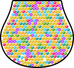
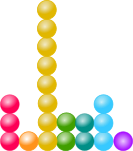
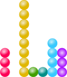
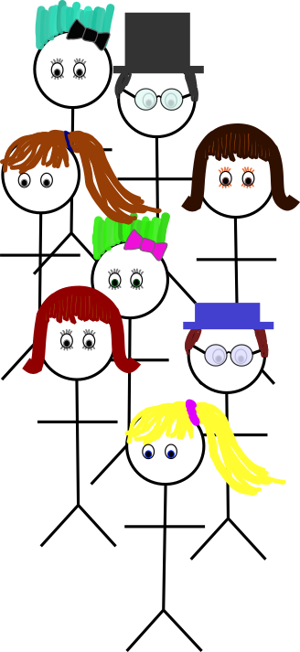
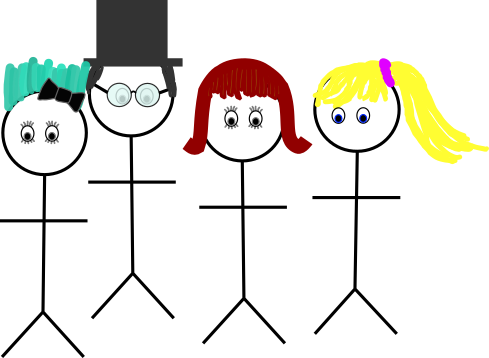
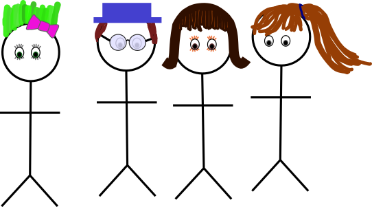

```{r}
#| label: setup
#| include: false


library(tibble)
library(dplyr)
library(purrr)
library(tidyr)
library(ggplot2)
library(ggdibbler)
library(distributional)
```

## Variables

- **Explanatory** or **Independent** Variable(s):     
variable(s) that may explain the change in the variable of interest

- **Response** or **Dependent** Variable(s)
  - variable(s) of interest we measure  on observational units

- **observational unit** - what is measured.     
[e.g. individuals for height, polls, etc., lifetime for mechanical parts, ...]{.emph .blue-dk}

::: fragment

- Goal: Show changes in the explanatory variable affect the response variable    
[**cause-and-effect** relationship]{.fragment .emph .green}

:::


## Review: Associations vs. Cause and Effect

- **Confounding variables** affect both the explanatory and response variables

  - Things that aren't measured
  - Things you can't control
  

{fig-alt="Simba, flying in from the left to hit zazu, who was sitting on a rock" width="50%"}

```{r}
#| include: false
balls <- rep(c("pink", "orange", "yellow", "green", "teal", "cyan", "purple"), c(29, 31, 187, 26, 46, 51, 45))
sample(balls, 20) |> table()
```

## Study Design -- Populations

::: {layout-ncol=2 layout-valign="bottom"}
{#fig-population-urn fig-alt="An urn shape containing 29 pink balls, 31 orange balls, 187 yellow balls, 26 green balls, 46 teal balls, 51 cyan balls, and 46 purple balls."}

{#fig-sample-urn fig-alt="A sample of 20 balls from the urn, containing 3 pink, 1 orange, 8 yellow, 2 green, 2 teal, 3 cyan, and one purple ball."}

:::


To generalize, [we need to **argue**]{.emph .blue-dk .large} that the sample is [**representative**]{.emph .large .green-dk} of the population


## Study Design -- Populations

::: columns
::: column

In a **random** sample,     
[**every item** in the population has an     
**equal chance** to be selected.]{.emph .cerulean-dk}

- Probability  $\Rightarrow$ this is representative. 

{fig-alt="A random sample of 20 balls from the urn, containing 3 pink, 1 orange, 8 yellow, 2 green, 2 teal, 3 cyan, and one purple ball."}

:::
::: column

In a **convenience** sample,     
we measure the [**most convenient**]{.emph .green} items.    
<br/>

- May be representative (or not) -- details matter.


{fig-alt="A convenience sample of 20 balls from the urn, containing 3 pink, 0 orange, 8 yellow, 1 green, 1 teal, 4 cyan, and 3 purple balls."}
:::
:::


A **random sample** means that the sample is [**representative**]{.emph .orange-dk .large} of the population    
[We can generalize results to the population.]{.emph .large .fragment}


## Study Design -- Experiments

In an **experiment**, the researcher assigns participants to conditions.

::: {layout="[1,-1, 2,2]" layout-valign="bottom"}

{fig-alt="A group of 8 stick figures with different hairstyles. For each basic hairstyle (hat, short hair, ponytail, spikes) there are two individuals with slight variations on the theme."}

{fig-alt="Four individuals, each with a different hairstyle."}

{fig-alt="Four individuals, each with a different hairstyle."}

:::

- With **random assignment**, any pre-existing difference in the groups is [due to **chance**]{.emph .large .cerulean-dk}.

- This allows us to detect [**cause-and-effect**]{.emph .large .pink-dk} relationships


## Additional Assumptions

- Surveys, convenience samples, etc. are common    
<br/>

- It's not always possible (or ethical) to do controlled experiments    
<br/>

- [Statistical **models**]{.emph .green} assume that the samples [**behave**]{.emph .pink-dk} like random samples, [**but**]{.emph .orange-dk}

    - We have to mention the assumptions we are making
    - We have to be careful about the conclusions
    
    
[[All models are wrong, but some are useful.]{.emph .blue-dk} -- George Box]{.fragment .large}

## Sources of Variability
::: columns
::: column

- Measurement error

- Natural variation

- Sampling -- which items were in the sample?


Probability is a useful way to handle *all* of these different types of variability     
[<br/>But, that doesn't mean they're the same!]{.fragment .emph .blue-dk}

:::

::: column
```{r}
#| fig-width: 4
#| fig-height: 2
#| fig-alt: A spaghetti plot of density functions that roughly follow a normal curve centered at 98 degrees. The x-axis shows Temperature (deg F) and the y axis shows density.
density_data <- tibble(
  xmean = rnorm(50, 98.1, .25),
  xse = .25
) |>
  mutate(xdist = dist_normal(xmean, xse),
         dist_group = factor(xdist)) |>
  group_by(dist_group) |>
  mutate(dist_group = cur_group_id()) |> 
  ungroup()

density_data |>
  ggplot(aes(x = xdist)) + geom_line(stat="density_sample", times = 100, alpha = .5) + 
  ggtitle("Thermometer Estimate: Normal Human Body Temperature") + 
  xlab("Temperature  (deg F)") + 
  ylab("Density") + theme_bw()

# This is just a reprex for Harriet
# density_data |>
#   ggplot(aes(x = xdist)) + geom_density_sample(times = 100, alpha = .5) + 
#   ggtitle("Thermometer Estimate: Normal Human Body Temperature") + 
#   xlab("Temperature  (deg F)") + 
#   ylab("Density") + theme_bw()
```

```{r}
#| fig-width: 4
#| fig-height: 2
#| fig-alt: A histogram of Stat 1080 attendance, with most days having between 20 and 30 students. The overall range lies between 12 and 36 students. 
set.seed(20261030)
df <- tibble(attendance = rbinom(15*3, size = 38, p = c(.5, .64, .8)))
df |> ggplot(aes(x = attendance)) + geom_histogram(binwidth = 1, fill = "grey", color = "black") + 
  theme_bw() + ylab("# Days") + xlab("# Students") + ggtitle("Stat 1080 attendance") + 
  scale_y_continuous(breaks = (0:5)*2) + 
  scale_x_continuous(breaks = (0:8)*5)
```


:::
:::


```{r}
#| fig-width: 9
#| fig-height: 1
#| out-width: 100%
#| fig-alt: 100 samples from the urn of marbles demonstrating that some variability is due to sampling error.
library(ggdibbler)
library(distributional)
ball_prob <- c(
  pink   = 29,
  orange = 31,
  yellow = 187,
  green  = 26,
  teal   = 46,
  cyan   = 51,
  purple = 45
)

colors <- c("#ff0056", "#ff931b", "#e1b700", "#419f00", "#008f87", "#37c9ff", "#a301ff")

ball_dist <- dist_multinomial(
  size = 20,
  prob = list(ball_prob)
)

df <- tibble(
  replicate = 1:100
  ) |> 
  mutate(outcome = map(replicate, ~generate(dist_categorical(prob = list(ball_prob), outcomes = list(colors)), times = 20))) |>
  unnest(outcome) |>
  unnest(outcome) |> 
  mutate(group = factor(outcome, levels = colors, labels = c("pink", "orange", "yellow", "green", "teal", "cyan", "purple"), ordered = T)) |>
  group_by(replicate) |> 
  mutate(prop_red = mean(group == "pink"), 
         prop_orange = mean(group == "orange"), 
         prop_yellow = mean(group == "yellow"), 
         prop_green = mean(group == "green"), 
         prop_teal = mean(group == "teal"), 
         prop_cyan = mean(group == "cyan"), 
         prop_purple = mean(group == "purple")) |>
  group_by(replicate, outcome, group, prop_red, prop_orange, prop_yellow, prop_green, prop_teal, prop_cyan, prop_purple) |>
  summarize(n = n()) |>
  ungroup() |>
  nest(data = c(outcome, group, n)) |>
  arrange(prop_red, desc(prop_purple), replicate) |>
  mutate(replicate2 = 1:n()) |>
  unnest(data)

ggplot(df, aes(fill = group, weight = n)) + 
  geom_bar(aes(x = replicate), position = "stack")+
  theme(legend.position="none", aspect.ratio = 1)+
  scale_fill_manual(values = colors) + theme_void() + 
  guides(fill = "none")
```