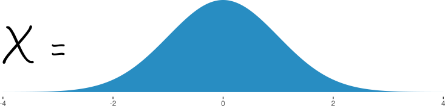
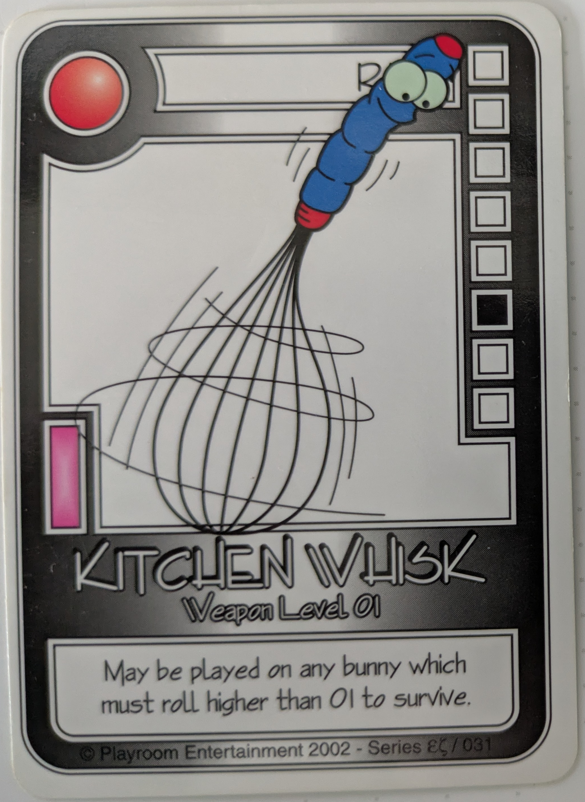

```{r}
#| include: false
#| label: setup
library(ggplot2)
library(tidyverse)
theme_set(theme_bw())
library(viridis)
```

## Variables

A **variable** is a placeholder for a quantity    
$x = 3,\ \  y=5, \ \ z=x^2+y^2$
```{r}
x <- 3
y <- 5
z <- x^2 + y^2
```

- We can change the values of $x, y, z$
- At any given time, the value of $x$ is known and fixed

## Random Variables 

A **random variable** is, well, random - its value is the outcome of a **random process**

{fig-alt="A normal density pdf, with text x=, as if the value of x were the whole normal density."}

- At any given time, $X$ has a **probabilistic** value -- we know the probability that $X=x$
- We can use $X$ as a regular variable for calculations

## Ex: Random Variables - Dice

::: columns
::: {.column width="20%"}
]{.small}](images/single-die.png){fig-alt="A single 6-sided die"}
:::
::: {.column width="80%"}
$$\displaystyle D = \begin{cases}1 & 1/6\\2 & 1/6\\3&1/6\\4&1/6\\5&1/6\\6&1/6\end{cases}\ \ \ \text{or} \ \ \ \ \ \text{Pr}(D=d) = 1/6 \ \ \ \ \text{for} \ \ d=1, 2, ..., 6$$
:::
:::

```{r}
#| echo: true
# Simulate rolls of a 6-sided die
set.seed(271828182)
x <- sample(size = 1000, x = 1:6, replace = T)
head(x, 10)
mean(x)
sd(x)
```


## Ex: Random Variables - Coins

::: {.columns  .v-center-container}
::: {.column width="20%"}
]{.small}](images/coin-flip.png){fig-alt="A hand flipping a coin" width="50%"}
:::
::: {.column width="80%" vertical-align="center"}
$$\begin{align}\displaystyle C = \begin{cases}1 & \text{if heads}\\0 & \text{if tails}\end{cases}\ \ \ \text{or} \ \ \ \ \ &\text{Pr}(C=c) = 1/2 \ \ \ \ \text{for} \ \ c=0,1\\
&C\sim\text{Bernoulli}(1/2)\end{align}$$

:::
:::

```{r}
#| echo: true
# Simulate flips of a fair coin (H=1)
set.seed(98728365)
x <- rbinom(1000, size = 1, prob = 0.5)
head(x, 10)
mean(x)
sd(x)
```

## Ex: Random Variables - Number of Events

::: {.columns  .v-center-container}
::: {.column width="20%"}
]{.small}](images/AggieBus1_ust.jpg){fig-alt="A USU bus"}
:::
::: {.column width="80%" vertical-align="center"}
$$\begin{align}\displaystyle X \sim \text{Poisson}(10)\end{align}$$
```{r}
#| fig-alt: "The PMF of a Poisson(10) random variable, with x-axis # Riders and y-axis Probability"
#| fig-width: 8
#| fig-height: 2
#| echo: false
tibble(x = 0:25, y = dpois(x, 10)) |>
  ggplot(aes(x = x, y = y)) + geom_col() + ylab("Probability") + xlab("# Riders") + ggtitle("Distribution of Bus Riders: Poisson(10)")
```

:::
:::


```{r}
#| echo: true
# Simulate number of riders waiting for the bus
set.seed(80581035)
x <- rpois(1000, lambda = 10)
head(x, 10)
mean(x)
sd(x)
```


## Random Variables: Distribution Functions

The CDF of a random variable contains all of the information about the outcomes of that RV. 

```{r}
#| echo: false
#| fig-width: 10
#| fig-height: 2
#| fig-alt: Three CDFs, one for a coin flip, one for rolling a 6-sided dice, and one for the number of riders waiting at a bus stop (Poisson(10)). 
#| out-width: "100%"
library(patchwork)
dicecdf <- function(x) {
  ((x >= 1) + (x >= 2) + (x >= 3) + (x >= 4) + (x >= 5) + (x >= 6))/6
}

coincdf <- function(x) {
  ((x >= 0) + (x >= 1))/2
}

bind_rows(
  tibble(x = seq(0.25, 6.25, .25), y = dicecdf(x), dist = "Dice"),
  tibble(x = seq(-0.25, 1.25, .25), y = coincdf(x), dist = "Coin"),
  tibble(x = seq(0, 20, .25), y = ppois(x, lambda = 10), dist = "N Riders Waiting")
) |>
  mutate(dist = factor(dist, levels = c("Coin", "Dice", "N Riders Waiting"), ordered = T)) |>
  ggplot(aes(x = x, y = y)) + geom_step() + facet_grid(~dist, scales = "free_x") + theme(axis.text.y = element_blank())
```

We can approximate distribution functions through Monte Carlo simulation, if one is not already pre-defined.


## Monte Carlo Simulation -- Answering Probability Questions

Suppose we want to know the probability of getting at least 3 heads when flipping a coin 4x.

```{r}
#| echo: true
N <- 1000 # Number of simulations
X <- rbinom(N, size = 4, prob = 0.5)
head(X, 10)
# How many times did we simulate the outcome?
n_times <- sum(X>=3)
# Divide by total # simulations
n_times/N
```

- Larger $N$ = more precision
- `size` and `prob` are set based on the problem -- 4 coin flips, fair coin


## Monte Carlo Simulation -- Answering Probability Questions

::: {layout-ncol=3}
{fig-alt="An image of the Killer Bunnies card game logo"}

{fig-alt="A card that says Kitchen Whisk (with a menacing looking kitchen wisk on it), with instructions 'May be played on any bunny which must roll higher than 01 to survive'. The card indicates a d-12 (twelve-sided die) should be rolled."}


{fig-alt="A card that says 7th Whisk (with seven flying kitchen wisks on it), with instructions 'May be played on any bunny which must roll higher than 01 on all seven dice to survive'. The card indicates seven d-12s (twelve-sided die) should be rolled."}

:::

- This game primarily uses D12s (12 sided dice)


## Monte Carlo Simulation -- Answering Probability Questions

$$X\ =\ \begin{cases}1 & \text{bunny dies}\\2, ..., 12 & \text{bunny survives}\end{cases}$$
$$Y\ =\ \begin{cases}1\  \text{on any die} & \text{bunny dies}\\2, ..., 12 \ \text{on every die} & \text{bunny survives}\end{cases}$$

```{r}
#| echo: true
set.seed(2048789234)
N <- 100000
one_roll <- sample(1:12, size = N, replace = T)
seven_rolls <- sample(1:12, size = N*7, replace = T) |> matrix(ncol = 7)

head(one_roll)
head(seven_rolls)

```

{fig-alt="A yellow timid-looking bunny" width="20%"}

## Monte Carlo Simulation -- Answering Probability Questions

```{r}
#| echo: true
head(rowSums(seven_rolls == 1), 20)


mean(one_roll == 1)
mean(rowSums(seven_rolls == 1) > 0)
```

So, while there's an 8% chance that the single whisk takes out a bunny, there's a 45% chance that 7 whisks working together take out a bunny.

## Expected Value and Standard Deviation

One of the most useful summaries of a random variable is the **expected value** 

- Long-run typical value
  - Coin Flip: 0.5 is the expected value if 1=Heads and 0=Tails
  - Dice Roll: 3.5 is the expected value if six-sided fair dice

- Calculate with simulation using `mean(x)`

The **standard deviation** describes how far, on average, a value is from the expected value.

- Calculate with simulation using `sd(x)`


## Expected Value and Standard Error

The **standard error** is the variability of an **estimate**. We might calculate the standard error of

- The expected value of 10 observations of a random variable
- The expected value of the sum of 10 observations of a random variable

$\sigma$ is the standard deviation of $X$

$\sigma/\sqrt{n}$ is the standard error of $\overline X$

## Tricks for Expected Values and Standard Deviations

$$E\left[\sum_{i=1}^n X_i \right] = \sum_{i=1}^n E\left[X_i\right]$$

If the $X_i$ have the same distribution, then $\displaystyle\sum_{i=1}^n E\left[X_i\right] = n E\left[X_i\right]$

```{r}
#| include: false
library(glue)
sprintf_transformer <- function(text, envir) {
  m <- regexpr(":.+$", text)
  if (m != -1) {
    format <- substring(regmatches(text, m), 2)
    regmatches(text, m) <- ""
    res <- identity_transformer(text, envir)
    do.call(sprintf, list(glue("%{format}"), res))
  } else {
    identity_transformer(text, envir)
  }
}

glue_fmt <- function(..., .envir = parent.frame()) {
  glue(..., .transformer = sprintf_transformer, .envir = .envir)
}
```

```{r}
#| echo: true
set.seed(204387)
x <- rnorm(1000, mean = 5, sd = 1)
x10 <- replicate(1000, sum(rnorm(10, mean = 5, sd = 1)))
```

```{r}
#| echo: false
#| fig-width: 8
#| fig-height: 2
#| fig-alt: Density curves from 1000 samples of x (Normal, mean 5, sd 1) and the sum of 10 x samples. The density of the sum is broader (higher sd) and centered around 50. 
data.frame(x10 = x10, x = x) |> 
  pivot_longer(1:2) |>
ggplot(aes(x = value, color = name)) + geom_density()
```
```{r}
#| output: 'asis'
glue_fmt("$$\\begin{{array}}{{rlrl}}
           E[x]&= {mean(x):2.3f} &SD[x]&= {sd(x):2.3f}\\\\ 
           E[\\sum_{{i=1}}^{{10}} x_i]&= {mean(y):2.3f}& SD[\\sum_{{i=1}}^{{10}} x_i]&= {sd(y):2.3f}\\end{{array}}$$")
```


## Tricks for Expected Values and Standard Deviations

Scaling $X_i$ works as expected: 

$$E\left[a X_i + b\right] = a E\left[X_i\right]+b$$

and when $X_i$ is scaled,

$$SD[aX_i + b] = |a| SD[X_i]$$

Shifting $X_i$ by $b$ does not change the variance, but multiplying by $a$ does. 

```{r}
#| echo: true
x <- rgamma(1000, 2, 1)
y <- 5*x+3
```
```{r}
#| output: 'asis'

glue_fmt("$$\\begin{{array}}{{rlrl}}
           E[x]&= {mean(x):2.3f} &SD[x]&= {sd(x):2.3f}\\\\ 
           E[5 x + 3]&= {mean(y):2.3f}& SD[5 x + 3]&= {sd(y):2.3f}\\\\ 
           5\\cdot E[x] + 3&= {5*mean(x)+3:2.3f}&     5\\cdot SD[x]&= {5*sd(x):2.3f}\\end{{array}}$$")
```


##  Tricks for Expected Values and Standard Deviations

If $X\sim\text{Normal}(\mu,\sigma)$, then $aX + b\sim\text{Normal}(a\mu+b, a\sigma)$

- This is specific to normal distributions
- Most distributions don't stay the same when variables are scaled


##  Tricks for Expected Values and Standard Deviations

If $X_i$ are independent (not related), then

$$\text{Var}\left[X_1 + ... + X_n\right] = \text{Var}\left[X_1\right] + ... + \text{Var}\left[X_n\right]$$

and so 

$$\text{SD}\left[X_1 + ... + X_n\right] = \sqrt{\text{SD}\left[X_1\right]^2 + ... + \text{SD}\left[X_n\right]^2}$$

If $X_i$ are also **identically distributed** then 

$$\text{Var}\left[X_1 + ... + X_n\right] = n \text{Var}\left[X\right] \ \ \ \text{and}\ \ \ \ \text{SD}\left[X_1 + ... + X_n\right] = \sqrt{n} \text{SD}\left[X\right]$$

## Law of Large Numbers
::: {.small}
Consider $\displaystyle\frac{1}{n} \sum_{i=1}^n X_i$ (the sample mean)

$$\displaystyle E\left[\frac{1}{n} \sum_{i=1}^n X_i\right] = \frac{1}{n}E\left[\sum_{i=1}^n X_i\right] = \frac{n}{n} E\left[X\right] =  E\left[X\right]$$

$$\displaystyle \text{SD}\left[\frac{1}{n} \sum_{i=1}^n X_i\right] = \frac{1}{n} SD\left[\sum_{i=1}^n X_i\right] = \frac{\sqrt{n}\cdot\text{SD}\left[X\right]}{n} = \frac{\text{SD}\left[X\right]}{\sqrt{n}}$$
:::

So, as $n$ increases, the variability of sample mean decreases!

```{r}
#| echo: false
#| fig-width: 8
#| fig-height: 2.5
#| out-width: 100%
#| fig-alt: Density curves drawn from 1000 samples of the average of each of $n=$ 10, 20, 30, 50, 100, and 300 normal random variables with mean 5 and standard deviation 3. As $n$ increases, the distributions have lower variance and the density is more concentrated around the common mean of 5. 

crossing(n = c(10, 20, 30, 50, 100, 300), rep = 1:1000) |>
  mutate(x = map_dbl(n, ~mean(rnorm(., mean = 5, sd = 3))),
         n = factor(n)) |>
  ggplot(aes(x = x, color = n, group = n)) + geom_density() + 
  scale_color_viridis("Average over n", end = .8, discrete = T, option = "C") + 
  guides(color = guide_legend(nrow = 1)) + 
  theme(legend.position = "bottom")
```


## Datasets and Probability Distributions

::: columns
::: column
::: callout-note
## Samples have Statistics

A **data set** is a **sample** from the population.

- It has mean $\overline X$ and standard deviation $s$
- $\overline X$ and $s$ are **sample statistics** 

{fig-alt="A histogram that is relatively symmetric with a smile that is waving its hands."}

:::
:::
::: column
::: callout-note
## Populations have Parameters
The population has a **probability distribution** (that is unknown)

- It has mean $\mu$ and standard deviation $\sigma$
- $\mu$ and $\sigma$ are **parameters** 

{fig-alt="A smooth normal curve with a smile and bow-tie giving a thumbs up sign."}

:::
:::
:::

We may model the population with a chosen **theoretical probability distribution** that uses the population parameters

- For instance, we may model $X \sim \text{Normal}(\mu, \sigma)$ 
- Our best estimates for $\mu, \sigma$ are often $\overline X, s$


