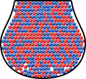

```{r}
library(tidyverse)
library(dslabs)
library(patchwork)
library(kableExtra)
theme_set(theme_bw())
```

## Review


- **population** - The entire collection of observational units we are interested in    
[population $\rightarrow$ **parameter**]{.large .emph .fragment .blue-dk}

- **sample** - The subset of the population on which we record data    
[sample $\rightarrow$ **statistic**]{.large .emph .fragment .blue-dk}


## Polling and Sampling

::: columns
::: column
{fig-alt="A large container filled with 201 red and 214 blue balls" width="50%"}
:::
::: column
We want to predict:

- $p$ - proportion of blue beads
- $1-p$ - proportion of red beads
- $p - (1-p) = 2p - 1$ - the **spread**, or difference between blue and red proportions


We sample $N$ balls randomly.
:::
:::


## Polling and Sampling

```{r}
set.seed(2043798)
s25 <- sample(rep(c("red", "blue"), c(201,214)), 25, replace = F) |> table()
options(digits = 4)
```

Let $N=25$. We sample `{r} s25[1]` red and `{r} s25[2]` blue balls.

{fig-alt="25 balls, 8 red, 17 blue" width="80%"}

$$
\begin{align}
\hat p\text{ (or }\overline X\text{)} & = 17/25 & = `{r} 17/25`\\
1-\hat p & = 8/25 &= `{r} 8/25`\\
2\hat p - 1& = 34/25 - 1 &= `{r} 9/25`\\
\text{SE}[\hat p] = \sqrt{\frac{\hat p (1-\hat p)}{N}} & = \sqrt{\frac{\frac{17}{25}\cdot\frac{8}{25}}{25}} &= `{r} sqrt(prod(s25/25)/25)`
\end{align}$$


## Sample Size and Standard Error

```{r}
set.seed(230947)
s50 <- sample(rep(c("red", "blue"), c(201,214)), 50, replace = F) |> table()
```

Let $N=50$. We sample `{r} s50[1]` red and `{r} s50[2]` blue balls.

{fig-alt="50 balls, 25 red, 25 blue" width="80%"}


$$
\begin{align}
\hat p\text{ (or }\overline X\text{)} & = 25/50 & = `{r} 25/50`\\
1-\hat p & = 25/50 &= `{r} 25/50`\\
2\hat p - 1& = 50/50 - 1 &= 0\\
\text{SE}[\hat p] = \sqrt{\frac{\hat p (1-\hat p)}{N}} & = \sqrt{\frac{\frac{25}{50}\cdot\frac{25}{50}}{50}} &= `{r} sqrt(prod(s50/50)/50)`
\end{align}$$

## Estimating Standard Error

```{r}
#| layout-nrow: 1
#| fig-width: 4
#| fig-height: 3
#| fig-alt: ['A plot of the sample standard error against the actual standard error using the population value of p. The variability around the standard error is higher when n is small, and the approximate SE is never higher than the actual SE.', 'A plot of the proportion of the actual standard error that the sample se is off from the true value. The proportion of error in the estimate decreases rapidly as n increases.']
true_p <- 214/415

se <- tibble(n = seq(10, 415, 1), 
             se = sqrt(true_p*(1-true_p)/n))

se_data <- se |>
  crossing(tibble(rep = 1:100)) |>
  mutate(sample = map_int(n, ~sum(sample(rep(c("red", "blue"), c(201,214)), ., replace = F) == "blue")))

se_data <- se_data |>
  mutate(sample_p = sample/n, sample_se = sqrt(sample_p * (1-sample_p)/n))

ggplot(data = se, aes(x = n)) +
  geom_point(data = se_data, aes(y = sample_se, color = "Estimated SE"), alpha = .05) + 
  geom_line(data = se, aes(y = se, color = "True SE")) + 
  scale_color_manual("", values = c("black", "red")) + 
  guides(color = guide_legend(override.aes = list(alpha = 1))) + 
  ylab("Standard Error") +  xlab("Sample Size") + 
  theme(legend.position = "inside", legend.position.inside = c(.8, .8), legend.title = element_blank())

ggplot(data = se_data, aes(x = n, y = se- sample_se)) + 
  geom_point(alpha = 0.5) + 
  ylab("Error in SE estimate") + 
  geom_smooth(se = F)
```

- Using $\text{SE}[\overline X]$ instead of $\text{SE}[p]$ adds in a little bit of error but is usually fairly close.
- The other option?    
Use $p=0.5$, which is the worst-case scenario for the SE, as $p(1-p)$ is maximized at $p=0.5$


## Central Limit Theorem

- When $N$ is large enough, $\overline X$ is approximately normally distributed

- Mean: 
  - $\text{E}[\overline X] = p$ (for proportions) 
  - $\text{E}[\overline X] = \mu$ (for continuous variables)

- Standard Deviation: 
  - $\text{SE}[\overline X] = \sqrt{\frac{p(1-p)}{N}} \approx \sqrt{\frac{\overline X(1-\overline X)}{N}}$ (proportions)
  - $\text{SE}[\overline X] = \text{SD}[X]/\sqrt{N}$ (continuous variables)

