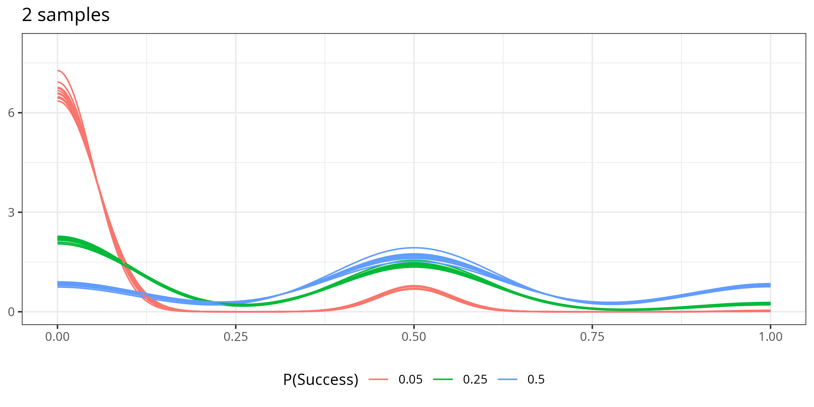
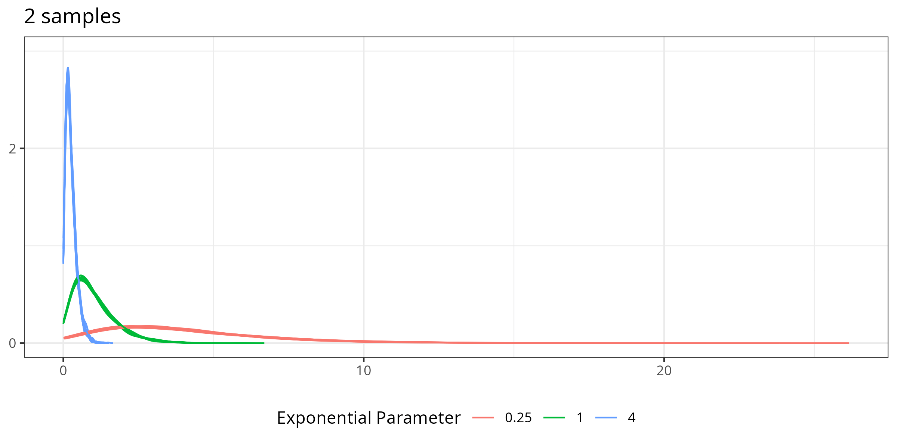
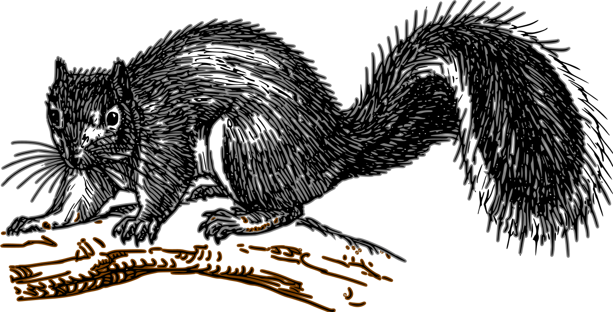

```{r}
#| include: false
#| label: setup
library(tidyverse)
library(ggplot2)
library(patchwork)
library(viridis)
library(gifski)
theme_set(theme_bw())
```

## Central Limit Theorem

$X$ is a random variable.

If the number of samples $N$ is large enough, then 
$$\overline X \sim \text{Normal}\left(E[X], \frac{SD[X]}{\sqrt{N}}\right)$$

## How Large is Large Enough?
### Discrete RVs

$$X = \begin{cases}0 & 1-p\\1 & p\end{cases}\ \ \ \ \ \ \text{compute}\ \overline X_n,\ \ \  n=\{2, 3, ..., 500\}$$

```{r}
#| eval: false

set.seed(203497)
cltdemo <- 
  crossing(n = c(2:25, seq(25, 50, 5), seq(60, 100, 10), seq(150, 500, 50)),
           p = c(.05, .25, .5),
           rep = 1:10) |>
  mutate(sample = pmap(list(n=1000, prob=p, size=n), 
                       .f = rbinom)) 

density_to_df <- function(...){
  tmp <- density(...)
  data.frame(x = tmp$x, y = tmp$y, bw = tmp$bw)
}

cltdens <- cltdemo |>
  mutate(n = n, p = p, rep = rep, density = map2(sample, n, ~density_to_df(.x/.y, adjust = 1.5, from = 0, to = 1))) 

cltdenslim <- cltdens |>
  unnest(density) |>
  group_by(n) |>
  summarize(y = max(y)) |>
  mutate(ylim = ceiling(cummax(y)))

for(i in unique(cltdemo$n)) {
  plot <- cltdens |>
    filter(n ==i) |>
    unnest(density) |>
    ggplot(aes(x = x, y = y, color = factor(p), group = factor(rep))) + 
    geom_line(aes(group = interaction(p, rep))) + 
    scale_color_discrete("P(Success)") + 
    theme(legend.position = "bottom", 
          axis.title = element_blank()) + 
    ggtitle(paste0(i, " samples")) + 
    scale_y_continuous(breaks = seq(0, 51, 3), limits = c(0, filter(cltdenslim, n==i)$ylim))
  ggsave(sprintf("images/clt-gif/%03d-bernoulli.png", i), plot = plot,
         width = 8, height = 4, units = "in", dpi = 300)
}

png_files <- list.files("images/clt-gif/", "*bernoulli.png", full.names = T)
png_filesrev <- c(png_files, rev(png_files)[-1])

gifski(png_filesrev, "images/clt-bernoulli.gif", delay = 0.5, loop = 1, width = 8*300, height = 4*300)

```

{fig-alt="A gif of the distribution of 1000 sample means of a binary (Bernoulli) random variable for each of n=2-500 samples (2-25, 25-50 by 5, 50-100 by 10, 150-500 by 50). 10 different sample densities are shown for each of p=0.05, 0.25, 0.50 probability of success. As n passes about 20, the densities for 0.25 and 0.50 begin to look approximately normal. As n passes about 70, the densities for 0.05 begin to look more normal as well." .fragment}

## How Large is Large Enough?
### Continuous RVs


$$X \sim \text{Exponential}(\lambda), \ \ \lambda = 0.25, 1, 4\\
E[X] = \frac{1}{\lambda}\ \ \ SD[X] = \frac{1}{\lambda}$$

Exponential distributions are *very* skewed (not symmetric)

```{r}
#| eval: false
set.seed(203342497)
cltdemo <- 
  crossing(n = c(2:40),
           p = c(0.25, 1, 4),
           rep = 1:10) |>
  mutate(sample = pmap(list(n=n, rate=p), 
                       .f = \(n, rate) replicate(1000, mean(rexp(n, rate)))))

density_to_df <- function(...){
  tmp <- density(...)
  data.frame(x = tmp$x, y = tmp$y, bw = tmp$bw)
}

cltdens <- cltdemo |>
  mutate(n = n, p = p, rep = rep, density = map(sample, ~density_to_df(.x, adjust = 1.5))) 

cltdenslim <- cltdens |>
  unnest(density) |>
  group_by(n) |>
  summarize(y = max(y), x = max(x)) |>
  mutate(ylim = ceiling(cummax(y)), 
         xlim = pmax(lag(x, 5, NA), lag(x, 4, NA), lag(x, 3, NA), lag(x, 2, NA), lag(x, 1, NA), x, lead(x, 1, NA), lead(x, 2, NA), lead(x, 3, NA), lead(x, 4, NA), lead(x, 5, NA), na.rm = T))


for(i in unique(cltdemo$n)) {
  plot <- cltdens |>
    filter(n ==i) |>
    unnest(density) |>
    ggplot(aes(x = x, y = y, color = factor(p), group = factor(rep))) + 
    geom_line(aes(group = interaction(p, rep))) + 
    scale_color_discrete("Exponential Parameter") + 
    theme(legend.position = "bottom", 
          axis.title = element_blank()) + 
    ggtitle(paste0(i, " samples")) + 
    scale_y_continuous(breaks = seq(0, max(cltdenslim$ylim), by = 2), limits = c(0, filter(cltdenslim, n==i)$ylim)) +
    scale_x_continuous("Sample Mean", limits = c(0,  filter(cltdenslim, n==i)$xlim))
  ggsave(sprintf("images/clt-gif/%03d-exp.png", i), plot = plot,
         width = 8, height = 4, units = "in", dpi = 300)
}

png_files <- list.files("images/clt-gif/", "*exp.png", full.names = T)
png_filesrev <- c(png_files, rev(png_files)[-1])

gifski(png_filesrev, "images/clt-exp.gif", delay = 0.5, loop = 1, width = 8*300, height = 4*300)

```


{fig-alt="A gif of the distribution of 1000 sample means of an exponential random variable for each of n=2-40 samples. 10 different sample densities are shown for each of lambda = 0.25, 1, and 4. As n passes about 10, the densities begin to look approximately normal." .fragment}

## Consequences of the Central Limit Theorem

The CLT allows us to 

- use the normal distribution to approximate almost any sample average

- calculate confidence regions and probabilities easily

- test whether our assumptions about the world are true (hypothesis testing)

## Example: Number of Squirrels

New York City conducts a [squirrel census](https://www.thesquirrelcensus.com) periodically^[There are even [playlists](https://soundcloud.com/squirrelcensus) to go along with it?].

We'll use the [2020 Squirrel Census conducted March 1, 2020](https://www.thesquirrelcensus.com/data) across several parks in Manhattan. 
A total of 433 squirrels were recorded.

Define $X = \begin{cases} 1 & \text{grey primary fur color}\\0 &\text{otherwise}\end{cases}$

```{r}
#| fig-width: 8
#| fig-height: 2
#| fig-alt: A stacked bar chart, oriented horizontally, showing the number of squirrels of each fur color in the data set. One squirrel has no recorded fur color. There are 16 black, 26 cinnamon, and 390 grey squirrels recorded in the dataset. 
#| out-extra: '.center'
df <- read_csv("squirrel-data.csv")

ggplot(df, aes(x = 1, fill = `Primary Fur Color`)) + 
  geom_bar() + 
  scale_fill_manual(values = c("black", "sienna", "grey40"), 
                    na.value = "magenta") + 
  ylab("# Squirrels") + theme(axis.text.y = element_blank(), axis.title.y = element_blank(), axis.ticks.y = element_blank()) + 
  coord_flip() + 
  theme(legend.position = "bottom")

```

$$\overline X = \frac{390}{433} = `{r} 390/433`$$
$$SE[\overline X] = \sqrt{\frac{\frac{390}{433}\cdot\frac{43}{433}}{433}} = `{r} sqrt(390*43/(433^3))`$$

## Example: Number of Squirrels


Assuming that the parks sampled during the 2020 squirrel census are a random sample of squirrels in NYC, what is the probability that the true proportion of gray squirrels in NYC is between .875 and .925?

::: fragment
$$\begin{align}P\left(.875 < p < .925\right) &= P\left(\overline X - .875 < \overline X - p < \overline X - .925\right) \\&= P\left(\frac{\overline X - .875}{SE[p]} < \frac{\overline X - p}{SE[p]} < \frac{\overline X - .925}{SE[p]}\right) \\&\approx P\left(\frac{0.901 - .875}{0.0144} < Z < \frac{0.901 - .925}{0.0144}\right) \\&=P\left(-1.667 < Z < 1.806\right)\end{align}$$
:::

::: fragment
```{r}
#| echo: true
pnorm(1.806)-pnorm(-1.667)
```
:::

{fig-alt="An image of a gray squirrel" width="30%" style="position:fixed;right:0px;bottom:0px"}

## Example 2: Surviving Winter

Steve and Jimmy are two squirrels who live in [McCarren Park](https://en.wikipedia.org/wiki/McCarren_Park) in Brooklyn.  

::: {layout-ncol=2}
{fig-alt="A cinnamon-colored squirrel" width="20%"}

{fig-alt="A grey-colored squirrel" width="40%"}

:::

Jimmy, a grey squirrel, prefers to hoard acorns from local oak trees, while Steve, a red squirrel, collects conifer seeds and mushrooms. Over a 30 day period, each squirrel keeps track of the "take" (in calories) from their respective foraging activities. 

Calculate the 95th percentile for each squirrel's average take, measured in calories. 


Steve | Jimmy
---- | ----
$\overline X = 250$ | $\overline X = 320$
$SE[\overline X] = 30.25$ | $SE[\overline X] = 45.15$


## Example 2: Surviving Winter

::: columns
::: column
{fig-alt="A cinnamon-colored squirrel" height="100px"}


$\overline X \sim \text{Normal}(250, 30.25)$

```{r}
#| echo: true
qnorm(.95, 250, 30.25)
```

:::
::: column

{fig-alt="A grey-colored squirrel" height="100px"}


$\overline X \sim \text{Normal}(320, 45.15)$


```{r}
#| echo: true
qnorm(.95, 320, 45.15)
```

:::
:::

## Estimates and Intervals

We can use a normal distribution to quantify the variability around sample statistics.

```{r}
x <- seq(-3, 3, .01)
df <- tibble(x = x, y = dnorm(x))
df_shaded <- filter(df, abs(x)<= 1.96)
df_unshaded <- anti_join(df, df_shaded)

ggplot(df, aes(x = x, y = y)) + 
  geom_ribbon(data = df_shaded, aes(ymax = y, ymin = 0), fill = "#f16278", alpha = 0.5) + 
  geom_line() + 
  geom_segment(aes(x = 0, xend = 0, y = 0, yend = 0.45), linetype = "dashed", linewidth = 0.25, inherit.aes = F) + 
  annotate("label", x = 0, y = 0.45, label = "Standardized  Estimate") +
  annotate("segment", x = -1.5,  y = 0.1, xend = 1.5, yend = 0.1, arrow = grid::arrow(ends = "both", type = "open", length = unit(0.1, "inches"))) + 
  annotate("label", x = 0, y = 0.1, label = "95% probability") + 
  geom_vline(xintercept = c(-1, 1) * 1.96) + 
  annotate("text", x = -1.96, y = 0.2, label = "z = -1.96", hjust = 1.1) + 
  annotate("text", x =  1.96, y = 0.2, label = "z =  1.96", hjust = -0.1) + 
  ylab("Density") + xlab("Z") + ggtitle("Normal Distribution") + 
  scale_x_continuous(breaks = -3:3)

```

Estimate $\pm 1.96 \cdot SE$ gives us an interval that covers 95% of the distribution of our estimate!

  
## Confidence Intervals

When $N$ is large enough, we can describe the precision of our estimate $\overline X$ with an interval

There is a 95% probability that the true value $p$ (or $\mu, \pi, \rho$^[You can use any symbol for the true value, but $p$ is often a bit over-used, with p-values, proportions, etc. Just be **consistent** within a single problem.]) falls within $1.96\cdot \hat{\text{SE}}[\overline X]$ of $\overline X$.

$$P\left(\underset{\text{lower bound}}{\underbrace{\overline X - 1.96\cdot \hat{\text{SE}}[\overline X]}} \leq p \leq \underset{\text{upper bound}}{\underbrace{\overline X + 1.96\cdot \hat{\text{SE}}[\overline X]}}\right) = 0.95$$

## Confidence Interval Interpretation

We interpret the $(a,b)$ interval $\left[\overline X - 1.96\cdot \hat{\text{SE}}[\overline X], \overline X + 1.96\cdot \hat{\text{SE}}[\overline X]\right]$ as:

::: {.large .center}
<br/>
We are [95%]{.emph .cerulean-dk} confident that    
[the **long-run average**]{.emph .cerulean-dk} \{... context ...\} $p$^[You can use any symbol for the true value, but $p$ is often a bit over-used, with p-values, proportions, etc. Just be **consistent** within a single problem.]    
[**lies between**]{.emph .cerulean-dk} $a$ and $b$,     
\{add specific problem context about what a and b mean here\}.  

:::

If there is a specific value that is important, add another sentence evaluating whether that value falls within the interval, and what that might tell you about the plausibility of the value.
